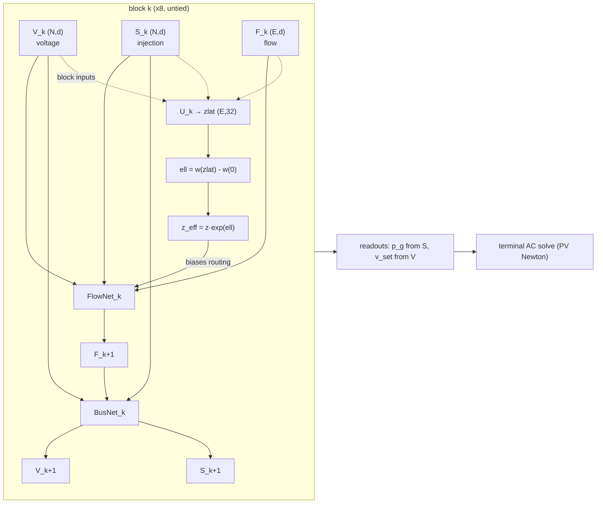

# PowerFORM: network architecture

PowerFORM (class `PowerForm`) is a power-system model whose hidden state is
**indexed by physical quantity**. Each stream stands for a named quantity, every
layer advances all of them together, and every decision is read from the stream it
physically belongs to.

The reconfiguration decision (which lines to open) is not a head on the side. It
rides a fourth stream, the line-status track, that the blocks **feed back into their
own routing**, so a decision changes the physics the next block sees.

---

## The whole picture

```
 inputs                    K = 8 untied blocks                      terminal
 ──────         ┌──────────────────────────────────────┐            ────────
                │  block k                             │
 loads  ──┐     │                                      │
 p, q     ├───► │   V_k ──────────┐                    │
          │     │   (N, d)        │  endpoints         │
 line     │     │                 ├──► FlowNet_k ──► F_k+1
 r, x  ───┤     │   S_k ──────────┘   routing biased   │
          │     │   (N, d)            by  z_eff        │
 edges    │     │                        ▲             │
 u, v  ───┤     │   F_k ─────────────────┘             │
          │     │   (E, d)                             │
 boxes    │     │                                      │
 p,v ─────┘     │   F_k+1 ──► BusNet_k ──► V_k+1, S_k+1│
                │                                      │
                │   ── line-status track (decision) ── │
                │   inputs = the signals FlowNet_k     │
                │   consumes, at its input:            │
                │     V[u], V[v], S[u], S[v],          │
                │     F_k, edge_emb, log z             │
                │              │                       │
                │              ▼                       │
                │   zlat_k+1 = zlat_k + U_k(·)   (E,32)│
                │   ell_k+1  = w(zlat_k+1) - w(0) (E,) │
                │   z_eff    = z · exp(ell)       ─────┼──┐ feeds the next
                │                                      │  │ block's routing
                └──────────────────────────────────────┘◄─┘
                                   │
                                   ▼
                    readouts (per block, box-constrained)
                      p_g   ← injection stream S
                      v_set ← voltage stream  V
                                   │
                                   ▼
                    ┌──────────────────────────────┐
                    │  terminal AC solve           │
                    │  PV Newton power flow        │
                    │  (physics/newton_solver.py)  │
                    └──────────────────────────────┘
                                   │
                     realised V, S, losses, feasibility
```



---

## Hidden state ↔ physical quantity

| stream | shape | stands for | who writes it | who reads it |
|---|---|---|---|---|
| `V` | `(N, d)` | bus voltage | BusNet | FlowNet routing, voltage readout |
| `S` | `(N, d)` | bus injection | BusNet | FlowNet routing, injection readout |
| `F` | `(E, d)` | line flow | FlowNet | BusNet aggregation, line-status track |
| `zlat` | `(E, 32)` | the line-status decision | `U_k` | `w` → gate, then routing |

`N` buses, `E` lines, `d = 216`, `K = 8` blocks.

**Type masking.** Whether a quantity is variable or constant, it shares the same
streams and interfaces. Binary masks decide at every block whether it is taken from
its evolving state or from its fixed embedding (`S_eff`, `V_eff`), so a quantity can
switch roles without changing its interaction path.

---

## Components

### FlowNet: the line stream (`model/flownet.py`)

One per block, untied. Each bus splits its injection over its incident lines with a
voltage-driven softmax, and the line variable is the signed sum of the contributions
from its two endpoints (KCL). A second stage lets lines that share a bus interact.
The routing score is biased by `alpha · log z_eff` and the output multiplied by
`z_eff`, so a line driven toward 0 stops carrying, which is how a discrete switching
choice becomes continuous physics the rest of the network can respond to.

With a track attached, `stash_inputs` exposes the block's input signals to it. A
decision read from the block's output would be reading a quantity it is itself
shrinking through `z`.

### BusNet: the bus streams (`model/busnet.py`)

One per block, untied. Attends over each bus's incident lines, gate-aware (the score
gets `alpha · log z` and the value a `z` factor, so an open line is a deleted line),
with separate attention for the two streams:

```
V_k+1 = (1 - g) · V_k + g · MLP^V[mix^V]        damped
S_k+1 = S_k + MLP^S[mix^S, V_k+1]               residual
```

The residual update keeps the injection-side inputs embedded in `S_0` (costs, the
network descriptors, generator limits) in the stream the dispatch readout reads.

### Generic maps (`model/generic.py`)

`maps="generic"` replaces both FlowNet and BusNet with one textbook pre-LN
graph-attention block (8 heads, node and edge MLPs) and keeps the same streams,
type masking, readouts, supervision and line-status gate. It is the comparison that
says what the physics maps contribute.

### Line-status track (`model/line_track.py`)

```
zlat_0    = 0                             (E, 32), per line
zlat_k+1  = zlat_k + U_k(inputs_k)        U_k: Linear(6d+1 → 32), zero-init
ell_k     = w(zlat_k) - w(0)              w:   Linear(32 → 1), shared
z_eff     = z · exp(ell_k)                multiplies the next block's routing
```

`inputs_k` is the concatenation of what FlowNet block *k* consumes:
`V[u], V[v], S[u], S[v], F_k, edge_emb, log z`, six `d`-wide signals plus one scalar,
hence `6d + 1 = 1297` inputs.

- **Identity at init.** `U_k` is zero-initialised, so `zlat` stays 0, `ell` stays 0,
  and `exp(0) = 1` exactly. The first forward of a pretrained model is bit-identical
  to the model without the track. (`exp` rather than `sigmoid` for this reason: a
  sigmoid's identity point is at infinite logit, where the gradient is dead.)
- **Feedback, not a head.** `ell` is consumed inside the trunk, so block `k+1` routes
  through a network the decision has already changed.

`ReconfigurationNet` attaches the track to a trunk and returns the terminal `ell_K`;
the lines to open are those with the lowest values.

### Readouts (`model/readouts.py`)

`p_g` is read from the injection stream, the voltage setpoint from the voltage stream,
and both are squashed into the task's own box (`TaskSpec`).

### Terminal AC solve (`physics/newton_solver.py`)

A PV Newton power flow closes every forward pass. The network proposes; the solver
decides what actually happens. Every gap, feasibility verdict and reference action
in the results traces back to this solve.

---

## Design variants

| variant | constructor argument | what changes |
|---|---|---|
| F1, no type masking | `type_masking=False` | constants only initialise the state |
| F2, merged readout | `merged_readout=True` | both decisions read the whole `[S, V]`, at half the hidden width |
| F3, final-layer supervision | training flag `--loss final-only` | only the last block is supervised |

---

## Parameter count

Measured with `d_model = 216`, `K = 8`, `maps="physics"`, `z_d = 32` by
`tests/test_model.py`. Only the input embedding depends on the number of cost features:

| part | ED prior (12) | Table 2 (10) | Table 1 (0) |
|---|---:|---:|---:|
| FlowNet blocks (×8) | 5,636,864 | 5,636,864 | 5,636,864 |
| BusNet blocks (×8) | 7,864,160 | 7,864,160 | 7,864,160 |
| embeddings, readouts, rest | 1,002,904 | 1,002,472 | 952,792 |
| **PowerFORM model** | **14,503,928** | **14,503,496** | **14,453,816** |

The ED-prior layout (12 cost features) is the Figure 1 initialisation; with the
line-status track (332,321) it is the reconfiguration model, **14,836,249** parameters
in both arms.

```python
from powerform.model.line_track import ReconfigurationNet
from powerform.model.powerform import PowerForm
m = PowerForm(n_cost_feats=12)
sum(p.numel() for p in m.parameters())                       # 14,503,928
sum(p.numel() for p in ReconfigurationNet(m).parameters())   # 14,836,249
```

`ReconfigurationNet` attaches the track to the model it is given, so count the model
first.

---

## Feasibility

A candidate action is rejected if the power flow diverges **or** the converged state
puts any bus voltage outside its box. Both live in one function
(`physics/feasibility.py:solve_loss`), shared by the expert loop, the scorer and the
reference search. The metric `infeasible_fraction` counts those rejections, and
`eval/infeasible_split.py` decomposes them into the two causes.

---

## Checkpoints

`{"model": state_dict, "config": {d_model, K, n_cost_feats, maps, generic_hidden,
type_masking, merged_readout}}`, with `z_d` as well on reconfiguration checkpoints.
Type masking changes no tensor shape, so the function comes from the config.
`eval/checkpoint.py:load_model` is the one loader and refuses unknown config keys.
